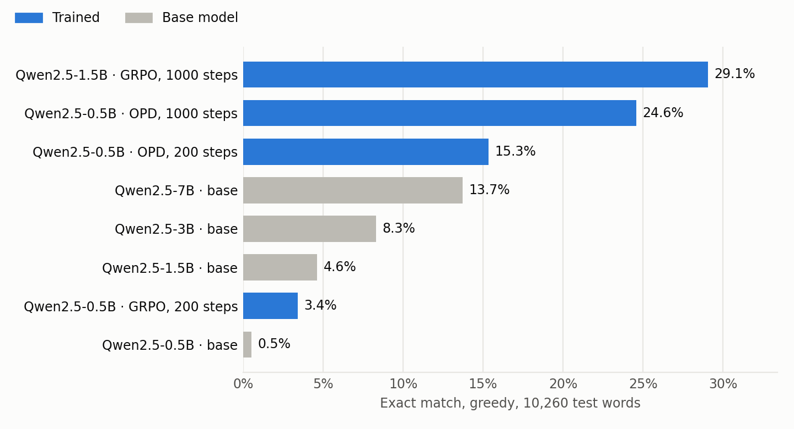
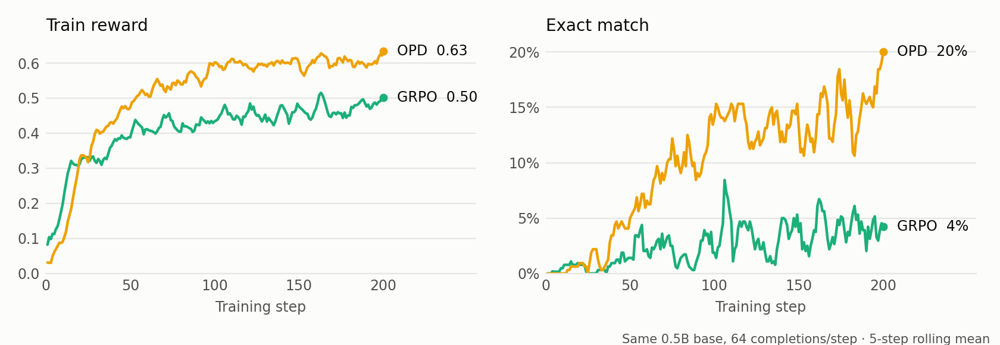
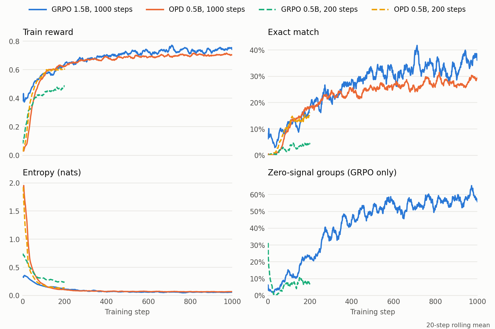
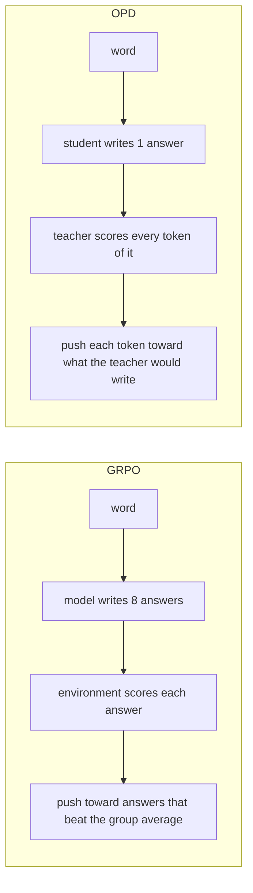

# telugu-rl-envs

Teaching small open models to write Telugu, with reinforcement learning.

This repo has **Telugu RL environments** (built on [OpenEnv](https://github.com/meta-pytorch/OpenEnv))
and the **training scripts** we used on them. The main task so far is **transliteration**: the model
gets a Telugu word typed in English letters and must write it in Telugu script.

Inspired by [AdithyaSK](https://huggingface.co/AdithyaSK)'s
[RL environments guide](https://huggingface.co/spaces/AdithyaSK/rl-environments-guide).

```
input:  nakshatram
answer: నక్షత్రం
```

Each episode is one word. `reset()` gives the model the word, `step(answer)` scores its answer
against a hidden reference: **reward = 0.8 × (1 − CER) + 0.2 × exact match** (CER = character error rate).

## What we found

All numbers: greedy decoding on all 10,260 Aksharantar Telugu test words, Kaggle 2×T4.

| Model | How it was trained | Reward | CER ↓ | Exact match |
|---|---|---:|---:|---:|
| Qwen2.5-0.5B-Instruct | none (base) | 0.156 | 0.806 | 0.5% |
| Qwen2.5-1.5B-Instruct | none (base) | 0.372 | 0.547 | 4.6% |
| Qwen2.5-3B-Instruct | none (base) | 0.432 | 0.480 | 8.3% |
| Qwen2.5-7B-Instruct | none (base) | 0.514 | 0.391 | 13.7% |
| **Qwen2.5-1.5B-Instruct** | **GRPO**, 1000 steps | **0.695** | **0.204** | **29.1%** |
| **Qwen2.5-0.5B-Instruct** | **OPD** from the GRPO 1.5B, 1000 steps | **0.666** | **0.229** | **24.6%** |

<picture>
  <source media="(prefers-color-scheme: dark)" srcset="results/plots/test-results-dark.png">
  
</picture>

In plain words:

1. **Base models are bad at this.** Even the 7B gets only 13.7% of words exactly right.
2. **GRPO fixes a lot.** 1000 steps of RL on the 1.5B take it from 4.6% to 29.1% exact, beating a
   base model 5× its size.
3. **On-policy distillation passes that skill down.** The GRPO 1.5B, used as a teacher, brings the
   0.5B from 0.5% to 24.6% exact: 96% of the teacher's reward with a third of its size, in 1.7 h of training.

**Is it OPD, or just more training?** To check, we trained the base 0.5B both ways for 200 steps
each (GRPO with the same settings as the 1.5B run), same test:

| Qwen2.5-0.5B-Instruct, 200 steps | Reward | CER ↓ | Exact match | Train time |
|---|---:|---:|---:|---:|
| base | 0.156 | 0.806 | 0.5% | |
| GRPO | 0.441 | 0.458 | 3.4% | 16 min |
| **OPD** | **0.592** | **0.299** | **15.3%** | 21 min |

<picture>
  <source media="(prefers-color-scheme: dark)" srcset="results/plots/grpo-vs-opd-05b-dark.png">
  
</picture>

For the 0.5B, OPD wins clearly: GRPO mostly gets closer spellings (lower CER) but rarely the exact
word, while OPD copies the teacher's skill and gets 4.5× as many words exactly right.

### Training curves

<picture>
  <source media="(prefers-color-scheme: dark)" srcset="results/plots/training-curves-dark.png">
  
</picture>

- **Entropy** collapses in every run: the models become nearly deterministic about each word.
- **Zero-signal groups** (GRPO groups where all 8 answers scored the same) climb to about 60% in the
  1.5B run, so late in training GRPO learns from fewer and fewer words; its reward levels off around 0.74.
- The **0.5B GRPO** run (green) has signal but stays under 5% exact: it learns closer spellings, not
  correct words.

Plot data is in [`results/`](results/); regenerate the images with `python scripts/plot_results.py`.

Trained adapter (1.5B GRPO): [makireddyvighnesh/Qwen2.5-1.5B-Instruct-telugu-translit-grpo](https://huggingface.co/makireddyvighnesh/Qwen2.5-1.5B-Instruct-telugu-translit-grpo).
Per-source breakdowns and sampling checks: [`results/baselines.md`](results/baselines.md).

## GRPO vs OPD in one picture

Both methods train only a small LoRA adapter, and both learn from the model's *own* answers.
They differ in where the learning signal comes from.



- **GRPO** needs some answers in a group to be better than others. If the model gets everything
  wrong (as the 0.5B base does on a quarter of words), there is nothing to learn from.
- **OPD** (on-policy distillation) gets a signal on every token, even when the whole answer is wrong,
  but it can only be as good as its teacher. That is why the teacher is the GRPO 1.5B, not a
  bigger base model: the 3B and 7B base models score below it.

## Quick start

Run the transliteration environment (playground at `http://localhost:8000/web`):

```bash
docker run -p 8000:8000 ghcr.io/makireddyvighnesh/telugu-transliteration-env:latest
```

Talk to it from Python:

```python
from telugu_transliteration.client import connect
from telugu_transliteration.models import TransliterationAction

with connect("http://localhost:8000") as env:
    obs = env.reset(split="test", index=0).observation   # obs.source_text, obs.prompt
    result = env.step(TransliterationAction(answer="నక్షత్రం"))
    print(result.reward, result.observation.metrics)      # cer, wer, exact_match, ...
```

Or run it from source:

```bash
pip install -e "./transliteration[train]"
python -m telugu_transliteration.data.prepare --output snapshot
TRANSLIT_SNAPSHOT=snapshot python -m telugu_transliteration.server.app
```

Task API, splits and grading: [`transliteration/README.md`](transliteration/README.md).

## Reproduce the results

```bash
pip install -e ".[train]"
```

**1. Evaluate a model** (greedy on the test set, plus 8 samples per word on 1,000 words):

```bash
python scripts/eval_text.py --model Qwen/Qwen2.5-1.5B-Instruct --replicas 2 --out outputs/eval
```

Add `--adapter <dir>` to evaluate a trained LoRA. For a model too big for one GPU (7B in fp16 on a T4),
use `--device-map auto` to split it across all GPUs.

**2. Train with GRPO** (one process per GPU):

```bash
accelerate launch --multi_gpu --num_processes 2 scripts/train_grpo_text.py \
    --model Qwen/Qwen2.5-1.5B-Instruct --max-steps 1000 --train-size 16000 --out outputs/grpo
```

This calls the environment's reward function in-process. To train through the environment server
instead (TRL `environment_factory`), see `python -m telugu_transliteration.train_grpo --help`.

**3. Distill with OPD** (one process: student on GPU 0, teacher on GPU 1):

```bash
python scripts/train_opd.py --max-steps 1000 --out outputs/opd
```

Defaults: student Qwen2.5-0.5B-Instruct, teacher Qwen2.5-1.5B-Instruct with the GRPO adapter above
merged in, reverse KL. Change them with `--model`, `--teacher`, `--teacher-adapter`.

**Kaggle notes:** T4s have no bf16, so everything runs in fp16. Run `pip uninstall -y torchao`
after installing; Kaggle ships torchao 0.10, which current PEFT rejects.

## How answers are scored

Both the answer and the reference are normalized first (following the Sarvam Indic OCR Bench rules):
Unicode NFKC/NFC, quotes and dashes, danda, zero-width joiners, HTML and bullets, Telugu digits to ASCII.
`<think>` blocks and code fences are stripped. Empty answers and answers that loop or balloon score 0,
so a model can't farm partial credit by repeating itself. CER is capped at 1 per answer.

## Other environments

Transliteration is the one we have trained on. The repo also has these, ready to use:

| Environment | Input → answer | Reward | Data |
|---|---|---|---|
| [Transliteration](transliteration/) | romanized word → Telugu script | 0.8 × (1 − CER) + 0.2 × exact | Aksharantar |
| OCR (`telugu_envs.ocr`) | image crop → text | 1 − CER | Nayana corpus, Nayana Natural, Sarvam Indic OCR Bench |
| ASR (`telugu_envs.asr`) | audio clip → text | 1 − CER | FLEURS `te_in` |
| Translation (`telugu_envs.text_env`) | English ↔ Telugu | chrF++ | Samanantar, FLORES+ |

<details>
<summary>Data sources (<code>telugu_envs.data.SOURCES</code>)</summary>

| Key | Task | Split | Dataset |
|---|---|---|---|
| `aksharantar` | transliteration | train / valid / test | `ai4bharat/Aksharantar`, 50.9k / 3.7k / 10.3k human-romanized pairs |
| `nayana_regions` | OCR | train | `Cognitive-Lab/NayanaOCR_Corpus_2025` [te], layout-region crops |
| `nayana_natural` | OCR | eval | `Cognitive-Lab/NayanaOCRBench_Natural` [te], 461 real pages |
| `sarvam` | OCR | test | `sarvamai/indic-ocr-bench`, 300 Telugu blocks |
| `fleurs` | ASR | train / validation / test | `google/fleurs` [te_in] |
| `samanantar` | translation | train | `ai4bharat/samanantar` [te] |
| `flores` | translation | dev / devtest | `openlanguagedata/flores_plus` (gated) |

</details>

## Repo layout

```
transliteration/      standalone OpenEnv environment: server, playground, client, Dockerfile
telugu_envs/          shared code
  text.py               normalization, output cleanup, loop detection
  reward.py             CER / WER / chrF rewards
  data.py               streaming data sources
  text_env.py           transliteration and translation environment
  ocr/ asr/             OCR and ASR environments
  base.py, server.py    shared environment base, OpenEnv FastAPI apps
scripts/
  train_grpo_text.py    GRPO training
  train_opd.py          on-policy distillation
  eval_text.py          evaluation
  plot_results.py       README plots
results/              all numbers, per-source breakdowns, plot data; plots/ holds the images
tests/
```

## Acknowledgements

This work was inspired by [AdithyaSK](https://huggingface.co/AdithyaSK)'s
[RL environments guide](https://huggingface.co/spaces/AdithyaSK/rl-environments-guide).

## License

The transliteration environment is Apache-2.0. Data keeps its own license: Aksharantar and FLEURS are CC BY 4.0,
Nayana is CC BY-NC 4.0, Samanantar is CC BY-NC.
