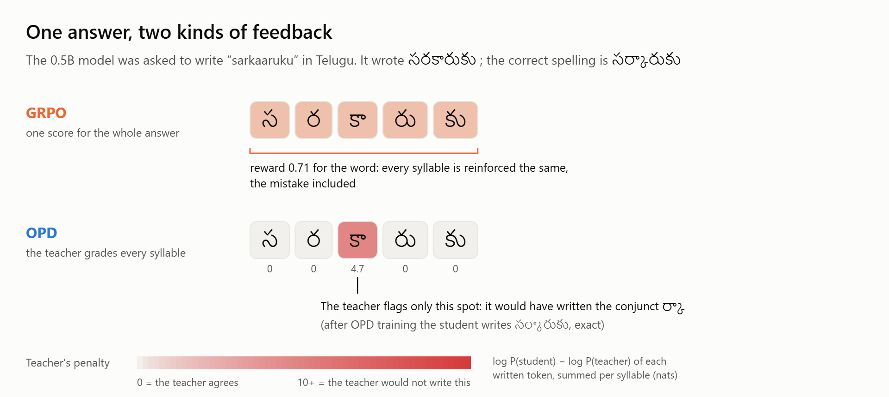
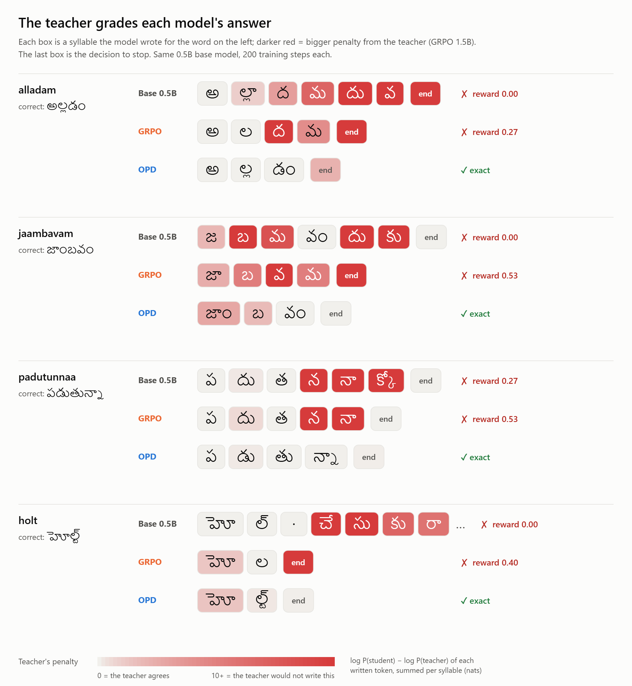
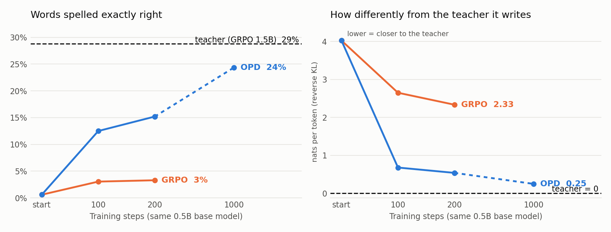
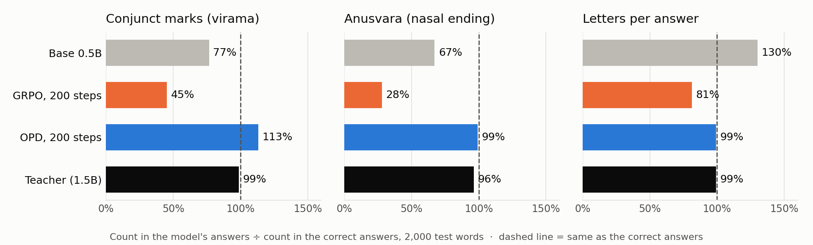
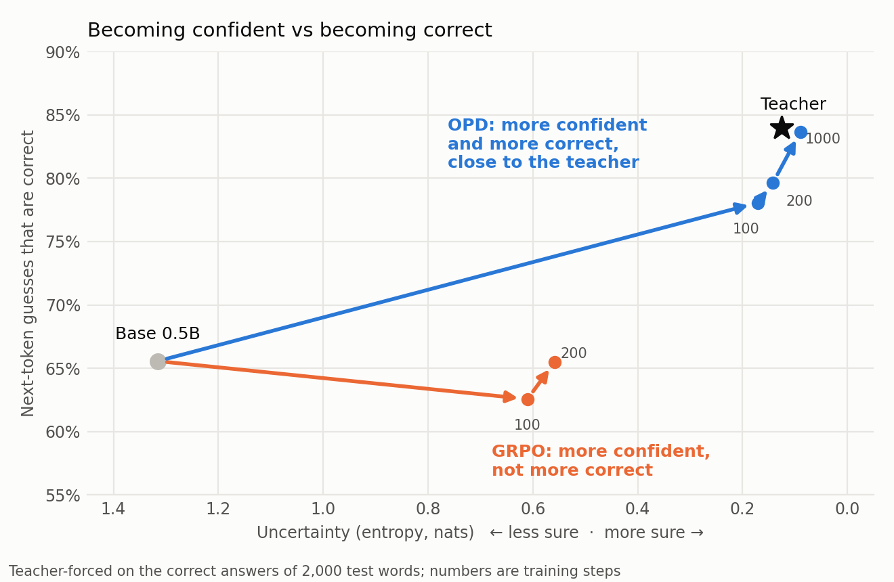

# What OPD changed that GRPO didn't

We trained the same small model, Qwen2.5-0.5B-Instruct, to transliterate Telugu in two ways, 200 steps
each. With on-policy distillation (OPD) it spells 15.3% of test words exactly right. With GRPO it spells
3.4%. This page looks inside the two models, token by token, to see where the difference comes from.

Inspired by Thinking Machines' [On-Policy Distillation](https://thinkingmachines.ai/blog/on-policy-distillation/) post.

## The idea in one table

Both methods train on the model's *own* answers (on-policy). They differ in how much feedback each
answer gets:

| Method | Learns from | Feedback per answer |
|---|---|---|
| GRPO | its own answers | **one number** for the whole word: `0.8 × (1 − CER) + 0.2 × exact` |
| OPD | its own answers | **a grade for every token**: how likely the teacher (our GRPO-trained 1.5B) is to write the same thing |

<picture>
  <source media="(prefers-color-scheme: dark)" srcset="plots/logprobs-feedback-dark.png">
  
</picture>

The base model writes సరకారుకు for *sarkaaruku*. The correct spelling has a conjunct, ర్కా, where the
model wrote two separate letters. GRPO scores the whole word 0.71, because most letters are right, and
reinforces every syllable alike, mistake included. The teacher instead puts its whole penalty (4.7) on the
one syllable where the conjunct should have been, and nothing on the rest. After 200 steps of OPD the
student writes the word exactly right.

## The teacher grades each model's answers

<picture>
  <source media="(prefers-color-scheme: dark)" srcset="plots/logprobs-graded-dark.png">
  
</picture>

Each box is a syllable a model wrote; the darker the red, the less the teacher agrees with it. The last
box, *end*, is the model's decision to stop writing. Three patterns repeat across the test set:

- **GRPO skips conjuncts.** In *alladam* it writes ల instead of ల్ల, and the teacher's penalty lands on
  the very next syllable, where the conjunct was abandoned.
- **GRPO stops early.** In *holt* it writes హోల and stops. The stop decision alone gets the biggest
  penalty in the row, because the teacher would have gone on to write the ్ట్ of హోల్ట్.
- **OPD's answers are almost white.** The teacher agrees with nearly every syllable.

## Results

### OPD closes most of the gap to the teacher; GRPO stalls

<picture>
  <source media="(prefers-color-scheme: dark)" srcset="plots/logprobs-learning-dark.png">
  
</picture>

| Model | Exact match | Reverse KL to teacher on its own answers | Teacher's top token = model's |
|---|---:|---:|---:|
| Base 0.5B | 0.6% | 4.02 | 54% |
| GRPO, 100 steps | 3.0% | 2.65 | 68% |
| GRPO, 200 steps | 3.3% | 2.33 | 71% |
| OPD, 100 steps | 12.5% | 0.68 | 85% |
| OPD, 200 steps | 15.2% | 0.54 | 87% |
| OPD, 1000 steps | 24.4% | 0.25 | 93% |
| Teacher (GRPO 1.5B) | 28.8% | 0 | 100% |

The right-hand panel is the quantity OPD minimizes. Most of the movement happens in the first 100
steps. GRPO also drifts toward the teacher, because right letters earn reward under both. But in 200
steps it closes 42% of the gap in reverse KL, where OPD closes 87%.

### What GRPO learned to leave out

<picture>
  <source media="(prefers-color-scheme: dark)" srcset="plots/logprobs-skipped-dark.png">
  
</picture>

After 200 steps, GRPO's answers contain only 45% of the conjunct marks (virama ్) and 28% of the
anusvaras (ం) that the correct answers have, and 81% of the letters. 70% of its answers are shorter
than the correct one. OPD and the teacher write about as many of each as the correct answers do.

The probabilities on the correct answers tell the same story (mean probability of the correct letter, %):

| Letter type | Base | GRPO-200 | OPD-200 | OPD-1000 | Teacher |
|---|---:|---:|---:|---:|---:|
| Consonant | 38 | 49 | 62 | 71 | 72 |
| Vowel sign | 38 | 48 | 69 | 74 | 73 |
| Conjunct mark (virama) | 30 | **19** | **88** | 93 | 91 |
| Anusvara / visarga | 22 | **20** | **83** | 92 | 92 |
| Stop at the end of the word | 53 | **92** | 84 | 85 | 81 |

GRPO made conjuncts *less* likely than the base model did (at step 100 the virama was down to 8%) and
made stopping more likely than even the teacher does.

**Why would GRPO do this?** For a weak model, a conjunct attempt is usually wrong. Under a CER-based
reward, a skipped letter costs one edit while a wrong attempt can cost several, so the shorter spelling
scores better on average and GRPO's group-relative advantage reinforces it. The result is a word that
earns partial credit but can never be exact. The 1.5B GRPO model didn't fall into this (its answers
contain 99% of the reference viramas), likely because its attempts were right often enough to pay off.
OPD avoids the trap by construction: the teacher puts high probability on the conjunct, so skipping it
is penalised at that exact token, whatever the word's final score. This explanation fits the numbers but
we haven't tested it directly, for example by retraining GRPO with an exact-match-only reward.

### More confident is not the same as more correct

<picture>
  <source media="(prefers-color-scheme: dark)" srcset="plots/logprobs-confidence-dark.png">
  
</picture>

Both methods make the model surer of itself (lower entropy). GRPO halved the uncertainty (1.32 → 0.56
nats), yet the model's first guess was correct as often as before (65.6% → 65.5%): it mostly sharpened
what it already preferred, mistakes included. OPD went up and to the right, ending next to the teacher
(OPD-1000: 83.7% correct first guesses at 0.09 nats; teacher: 84.0% at 0.13).

### The price of OPD's confidence

Reverse KL is *mode-seeking*: the student learns to commit to the teacher's favourite token rather than
spreading its bets. When the OPD student commits to the wrong letter, it is confidently wrong. Counting
correct letters whose probability fell more than about 3,000-fold (8 nats) compared with the base
model: OPD has 1,994 of 18,610 against GRPO's 848. On the words it knows best, the 1000-step OPD student
is even slightly more confident than its teacher: it gives the correct word more than 50% probability on
9.4% of words, against the teacher's 8.9%.

## How this was measured

- **Models**: base 0.5B; GRPO 0.5B after 100 and 200 steps; OPD 0.5B after 100, 200 and 1000 steps; the
  teacher (the GRPO-trained 1.5B that OPD learned from).
- **Words**: 2,000 Aksharantar Telugu test words, evenly spaced through the test split. Exact-match
  rates on this subset agree with the full 10,260-word evaluation.
- **On the correct answers**: each model reads the prompt plus the correct answer. At every answer token
  we record the probability of the correct token, whether it is the model's first choice, the model's
  entropy, and the full-vocabulary reverse KL to the teacher.
- **On the model's own answers**: each model writes its greedy answer. For each token it chose, we record
  the teacher's view: the reverse KL, whether the teacher's first choice agrees, and the penalty
  `log P(student) − log P(teacher)` of the chosen token. That penalty is the per-token signal OPD trains
  on, and it is what the graded figures show.
- **Letters and syllables**: Qwen splits Telugu into byte pieces, 1–2 tokens per letter. Token values are
  summed into the letter they complete, and letters into syllables (a consonant plus its vowel sign,
  virama, anusvara and any consonant joined to it).

To regenerate:

```bash
python scripts/analyze_logprobs.py --n 2000 --out outputs/logprob-analysis --model base=Qwen/Qwen2.5-0.5B-Instruct \
    --model grpo-200=Qwen/Qwen2.5-0.5B-Instruct:<grpo adapter> --model opd-200=Qwen/Qwen2.5-0.5B-Instruct:<opd adapter> ...
python scripts/plot_logprobs.py --data outputs/logprob-analysis
python -m http.server 8000   # then open http://localhost:8000/scripts/graded_answers.html for the two graded figures
```

The analysis ran on Kaggle 2×T4 in about 16 minutes. Numbers per model are in
[`logprob_summary.csv`](logprob_summary.csv); the graded examples are in
[`graded_examples.json`](graded_examples.json).

## Caveats

- One run per method, one seed. The gaps are large and consistent across 2,000 words, but exact numbers
  would move with another seed.
- The two methods used their own learning rates (GRPO 5e-5, OPD 1e-4) and sampling temperatures (0.7
  vs 1.0), as in the training runs.
- OPD can only get as good as its teacher. The 1000-step OPD student is already within one to two points
  of it on every measure here.
- The four graded examples were chosen as words OPD gets right and GRPO doesn't. They show typical
  patterns, but they are not a random sample.
