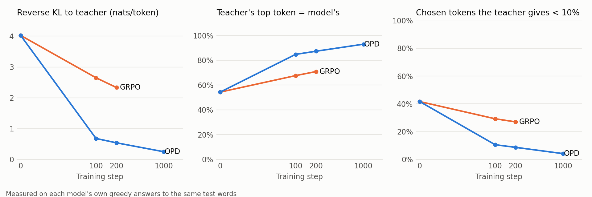
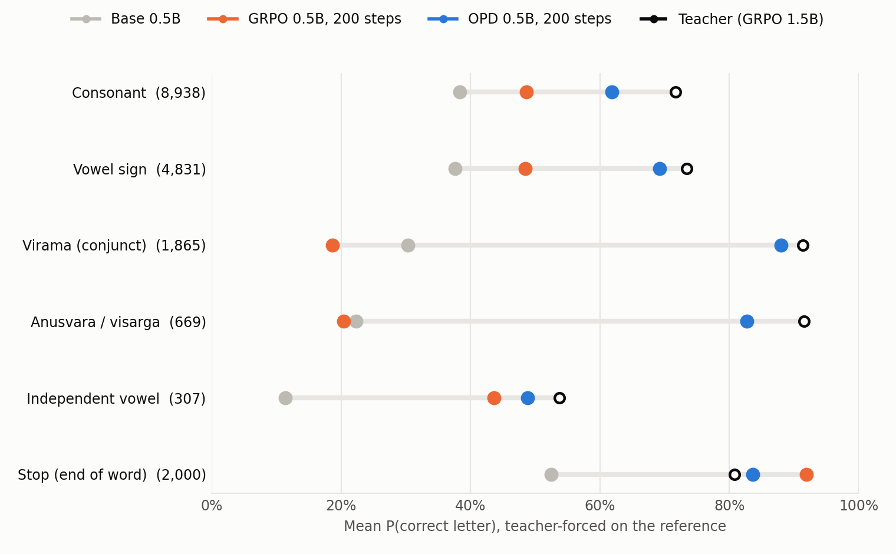
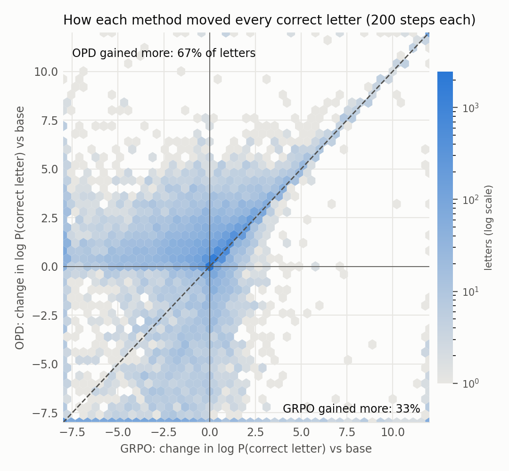
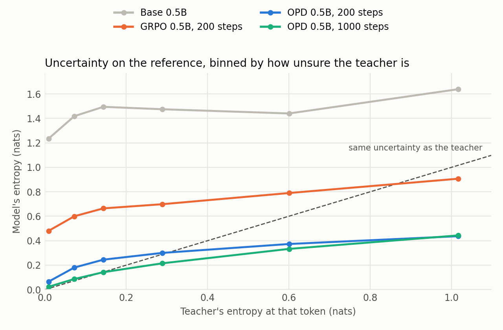
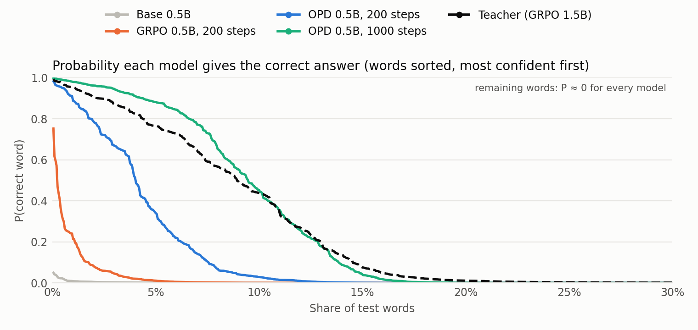
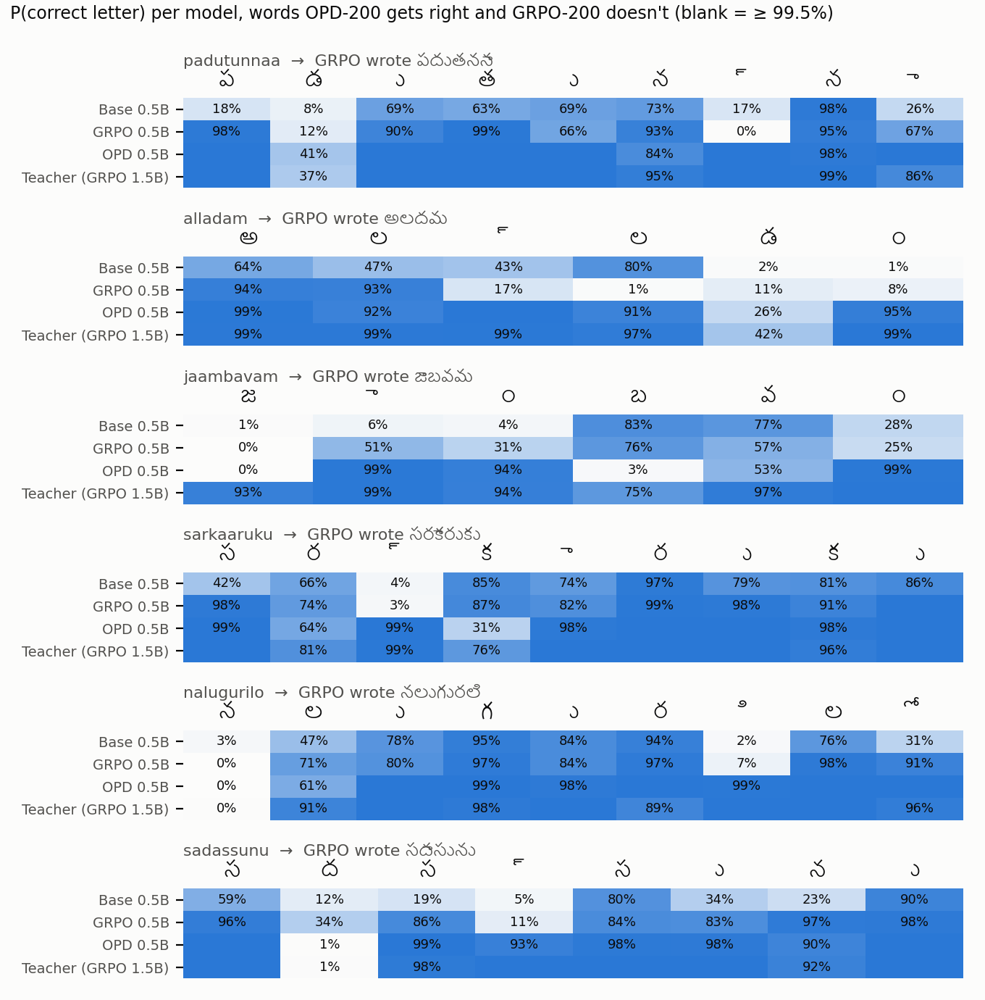

# How OPD and GRPO changed the 0.5B, token by token

GRPO and OPD both trained the same Qwen2.5-0.5B-Instruct for 200 steps (64 completions per step).
OPD ended at 15.3% exact match on the test set, GRPO at 3.4%. This page looks inside the models to see
**why**: what each method did to the next-token probabilities, and which tokens it taught the model to pick.

## Short version

1. **GRPO taught the 0.5B to write simplified, shorter words.** It almost stopped writing the virama
   (్, which joins consonants into conjuncts) and the anusvara (ం), and it learned to stop early. Its
   answers have 6.8 letters where the references have 8.3. On the CER reward that trade is "safe":
   a dropped letter costs one edit, a wrong conjunct can cost several. But a word with a missing letter
   is never an exact match.
2. **GRPO made the model more confident without making it more correct.** Entropy fell from 1.32 to
   0.56 nats, but the correct token was the model's top choice exactly as often as before (65.6% →
   65.5%). It mostly sharpened what the base model already preferred, mistakes included.
3. **OPD copied the teacher's choices, letter by letter.** On the model's own answers, the reverse KL to
   the teacher fell from 4.0 to 0.54 nats per token (GRPO: 2.3). The teacher's top token matched the
   student's 87% of the time (GRPO: 71%), and the student picked a token the teacher gives under 10%
   only 9% of the time (GRPO: 27%).
4. **The biggest OPD gains are exactly the letters GRPO gave up.** P(correct virama) went 30% → 88% with
   OPD and 30% → 19% with GRPO; anusvara/visarga 22% → 83% vs 22% → 20%.
5. **OPD also copied how unsure the teacher is.** Where the teacher is confident, the OPD student is
   too; where the teacher hesitates, the student's entropy rises with it. GRPO's entropy barely depends on
   the teacher's.

## Method

- **Models**: base 0.5B; GRPO 0.5B at steps 100 and 200; OPD 0.5B at steps 100, 200 and 1000; the
  teacher (the GRPO-trained 1.5B that OPD learned from).
- **Words**: 2,000 Aksharantar Telugu test words, evenly spaced through the test split.
- **Reference pass**: each model reads the prompt plus the *correct* answer (teacher forcing). At every
  answer token we record the probability of the correct token, whether it is the model's top choice, the
  model's entropy, and the full-vocabulary reverse KL(model ‖ teacher).
- **Greedy pass**: each model writes its own greedy answer. For every token it chose we record the
  teacher's probability of that token, whether the teacher's top choice agrees, and the reverse KL. This
  is the quantity OPD minimizes, measured on the model's own rollouts.
- **Letters, not bytes**: Qwen splits Telugu into byte pieces (1–2 tokens per letter), so token
  log-probs are summed into the Telugu letter (Unicode code point) they belong to, and each letter is
  labelled consonant, vowel sign, virama, anusvara/visarga or independent vowel. "Stop" is the end-of-answer token.

Code: [`scripts/analyze_logprobs.py`](../scripts/analyze_logprobs.py) (ran on Kaggle 2×T4, about 16 min)
and [`scripts/plot_logprobs.py`](../scripts/plot_logprobs.py). Summary table:
[`logprob_summary.csv`](logprob_summary.csv). The exact-match rates from this run (GRPO-200 3.3%,
OPD-200 15.2%, OPD-1000 24.4%, teacher 28.8%) agree with the full test-set evaluation.

## 1. On its own answers, OPD moves toward the teacher; GRPO much less

<picture>
  <source media="(prefers-color-scheme: dark)" srcset="plots/logprobs-alignment-dark.png">
  
</picture>

| Model | Reverse KL to teacher | Teacher's top token = model's | Chosen tokens teacher gives < 10% |
|---|---:|---:|---:|
| Base 0.5B | 4.02 | 54% | 42% |
| GRPO, 100 steps | 2.65 | 68% | 29% |
| GRPO, 200 steps | 2.33 | 71% | 27% |
| OPD, 100 steps | 0.68 | 85% | 11% |
| OPD, 200 steps | 0.54 | 87% | 9% |
| OPD, 1000 steps | 0.25 | 93% | 4% |

Most of OPD's movement happens in the first 100 steps. GRPO also moves toward the teacher, since both
are rewarded for right letters, but it gets about a quarter of the way in the same number of steps.

## 2. Where the probability went: letter types

<picture>
  <source media="(prefers-color-scheme: dark)" srcset="plots/logprobs-by-class-dark.png">
  
</picture>

Mean P(correct letter) on the reference, in %:

| Letter type | Base | GRPO-200 | OPD-200 | OPD-1000 | Teacher |
|---|---:|---:|---:|---:|---:|
| Consonant | 38 | 49 | 62 | 71 | 72 |
| Vowel sign | 38 | 48 | 69 | 74 | 73 |
| Virama (conjunct) | 30 | **19** | **88** | 93 | 91 |
| Anusvara / visarga | 22 | **20** | **83** | 92 | 92 |
| Independent vowel | 11 | 44 | 49 | 54 | 54 |
| Stop (end of answer) | 53 | **92** | 84 | 85 | 81 |

GRPO improved the ordinary letters a little and made the virama and anusvara *less* likely than in the
base model (at step 100 the virama was down to 8%). It also pushed the stop token above the teacher's
level: the GRPO model is more eager to end the word than the teacher is.

The answers show the same thing:

| Model | Letters per answer (reference: 8.3) | Answers shorter than reference | Viramas written vs reference | Anusvaras written vs reference |
|---|---:|---:|---:|---:|
| Base 0.5B | 10.8 | 20% | 77% | 67% |
| GRPO, 100 steps | 6.7 | 72% | 21% | 16% |
| GRPO, 200 steps | 6.8 | 70% | 45% | 28% |
| OPD, 200 steps | 8.2 | 27% | 113% | 99% |
| OPD, 1000 steps | 8.2 | 21% | 108% | 98% |
| Teacher | 8.2 | 22% | 99% | 96% |

This is a local optimum of the GRPO reward for a weak model. The base 0.5B's conjuncts are usually
wrong, and under `0.8 × (1 − CER) + 0.2 × exact` a skipped letter loses less reward on average than a
wrong attempt. So the group-relative advantage favours the shorter answer, and the model drifts toward
simplified spellings that cannot be exact. The 1.5B GRPO model did not fall into this (it writes 99% of
the reference viramas), likely because its conjunct attempts were right often enough to be rewarded.
OPD avoids the trap by design: the teacher puts high probability on the virama, so leaving it out is
penalised at that token, whatever the word's final score.

## 3. Letter by letter: who gained more

<picture>
  <source media="(prefers-color-scheme: dark)" srcset="plots/logprobs-delta-dark.png">
  
</picture>

Each point is one correct letter in one test word: how much GRPO (x) and OPD (y) changed its
log-probability from the base model. Above the diagonal, OPD raised it more: 67% of letters.

The bands along the left and bottom edges (clipped at −8 nats, i.e. about 3,000× less likely) are letters
a method made much *less* likely. OPD has more of them: 1,994 of 18,610 letters, against GRPO's 848.
That is the cost of OPD's confidence (entropy 0.14): when the student has committed to a different
letter, the correct one gets almost nothing. OPD's drops follow the overall mix of letter types. GRPO's
are 75% consonants, and viramas are over-represented (21% of its drops, against 10% of all letters).

## 4. Confidence: matching the teacher vs sharpening

<picture>
  <source media="(prefers-color-scheme: dark)" srcset="plots/logprobs-entropy-dark.png">
  
</picture>

| | Base | GRPO-200 | OPD-200 | OPD-1000 | Teacher |
|---|---:|---:|---:|---:|---:|
| Mean entropy on the reference (nats) | 1.32 | 0.56 | 0.14 | 0.09 | 0.13 |
| Correct token is the model's top choice | 65.6% | 65.5% | 79.7% | 83.7% | 84.0% |

GRPO's line sits high and nearly flat: it became more confident everywhere by about the same amount,
regardless of whether the letter is easy or genuinely ambiguous, and without picking the right letter
more often. The OPD lines rise with the teacher's entropy: confident where the teacher is confident,
less so where the teacher hesitates. At high teacher entropy OPD falls below the diagonal: reverse KL is
mode-seeking, so when the teacher spreads its probability, the student commits to the teacher's
favourite option rather than copying the spread.

## 5. Probability of the whole correct word

<picture>
  <source media="(prefers-color-scheme: dark)" srcset="plots/logprobs-word-prob-dark.png">
  
</picture>

Words where the model gives the correct answer more than 50% probability: base 0%, GRPO-200 0.2%,
OPD-200 4.0%, OPD-1000 9.4%, teacher 8.9%. After 1000 steps the OPD student is slightly *more* confident
than its teacher on the words it knows best, again the mode-seeking effect.

The *mean* log-probability of the correct word gets worse after training for every 0.5B model (base
−19.0, GRPO-200 −24.6, OPD-200 −25.4). That is not a contradiction: a confident model that is wrong gives
the correct letter almost zero probability, so its few wrong words have very negative log-probabilities.
The base model is unsure about everything, which makes no word extremely unlikely. That is why this page
uses top-1 rates, per-letter probabilities and sorted curves instead of means of log-probabilities.

## 6. Examples

<picture>
  <source media="(prefers-color-scheme: dark)" srcset="plots/logprobs-examples-dark.png">
  
</picture>

Words OPD-200 gets right and GRPO-200 doesn't. Each column is one Telugu code point of the correct
answer (vowel signs and viramas are drawn on their own because the plot doesn't join letters). The
pattern repeats: GRPO's weak spots are the virama columns (్ in *alladam*, *sarkaaruku*, *padutunnaa*)
and the final anusvara (ం in *alladam*, *jaambavam*), where OPD and the teacher are near 100%.

## Caveats

- One run each, 200 steps, one seed. The direction of the gaps is large and consistent across 2,000
  words, but exact numbers would move with another seed.
- The two methods used their own learning rates (GRPO 5e-5, OPD 1e-4) and sampling temperatures
  (0.7 vs 1.0), as in the training runs.
- "Teacher" is the GRPO 1.5B. OPD can only reach its teacher; OPD-1000 is already within 1–2 points of it
  on every measure here.
- The explanation for GRPO dropping conjuncts (a skipped letter is cheaper than a wrong one under CER) is
  an interpretation that fits the numbers. It was not tested directly, for example by retraining with an
  exact-match-only reward.
